<div align="center">

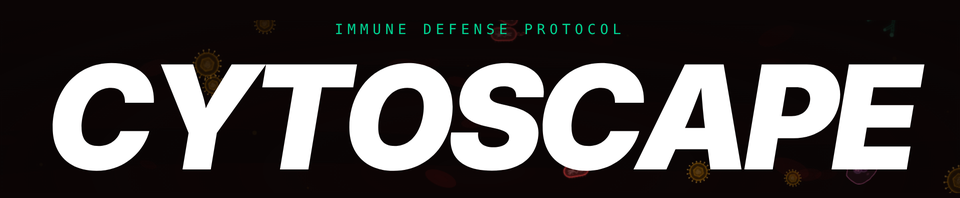

# Cytoscape: Immune Defense

**You are a T-cell. Hunt viruses, bacteria, parasites and fungi before they overrun the host.**

An Asteroids-style arcade shooter set in the bloodstream, with nine bosses based on real biology, four playable immune cells, a 30-mission campaign and a codex of real immunology. Free, open source, and playable in any browser.

[](https://cptnope.itch.io/cytoscape-immune-defense)
[](https://cptnope.github.io/Cytoscape-Immune-Defense/)
[](https://cptnope.itch.io/cytoscape-immune-defense/donate)
<br />
[](https://github.com/CptNope/Cytoscape-Immune-Defense/actions/workflows/deploy.yml)
[](https://github.com/CptNope/Cytoscape-Immune-Defense/actions/workflows/ci.yml)

[](LICENSE)

**[▶ Play on itch.io](https://cptnope.itch.io/cytoscape-immune-defense)** ·
**[▶ Play the installable web app](https://cptnope.github.io/Cytoscape-Immune-Defense/)** ([skip the intro](https://cptnope.github.io/Cytoscape-Immune-Defense/#play)) ·
**[♥ Support development](https://cptnope.itch.io/cytoscape-immune-defense/donate)**

[Gameplay guide](docs/GAMEPLAY.md) · [Architecture](docs/ARCHITECTURE.md) · [Deployment](docs/DEPLOYMENT.md) · [Contributing](CONTRIBUTING.md) · [Changelog](CHANGELOG.md) · [Roadmap](ROADMAP.md)

</div>

---

## Contents

- [Screenshots](#screenshots)
- [About](#about)
- [Where to play](#where-to-play)
- [Features](#features)
- [How to play](#how-to-play)
- [Documentation](#documentation)
- [Tech stack](#tech-stack)
- [Architecture at a glance](#architecture-at-a-glance)
- [Development](#development)
- [Deployment](#deployment)
- [Support the game](#support-the-game)
- [Contributing](#contributing)
- [Credits](#credits)
- [License](#license)

## Screenshots

| | |
|:---:|:---:|
| 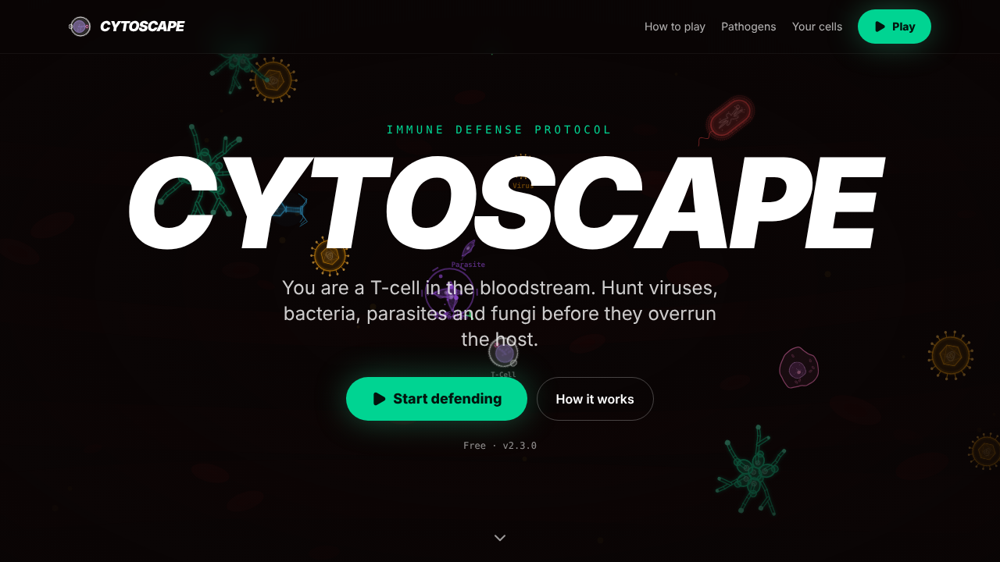 | 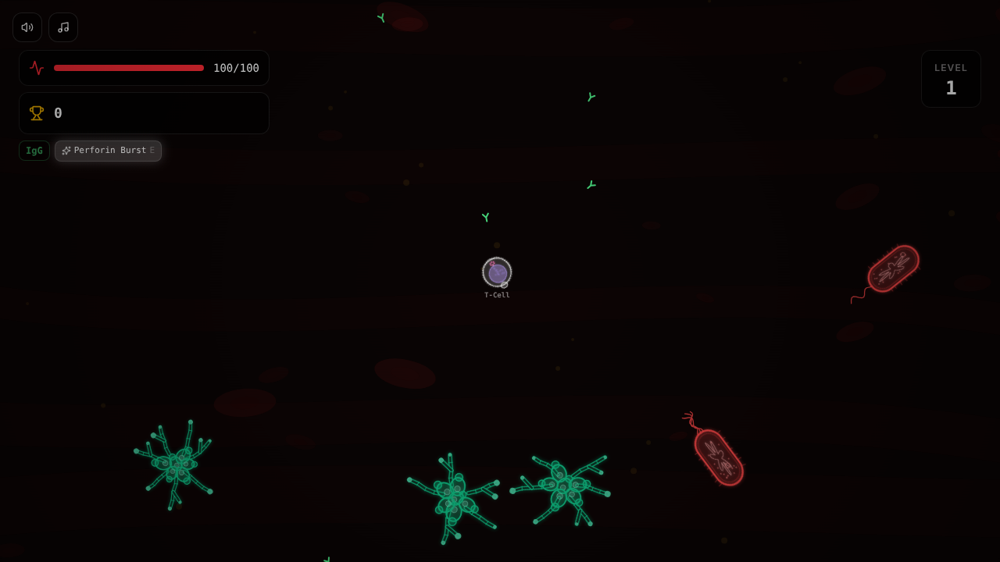 |
| **Landing page**: the game plays itself behind the title | **Endless mode**: a T-cell against viruses and bacteria |
| 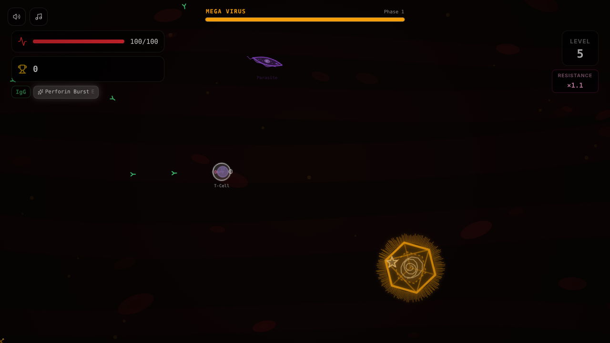 | 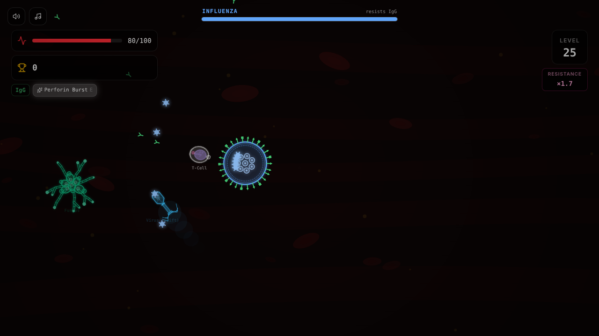 |
| **Mega Virus**: the first boss, a shielded capsid | **Influenza**: resists one antibody class at a time |
| 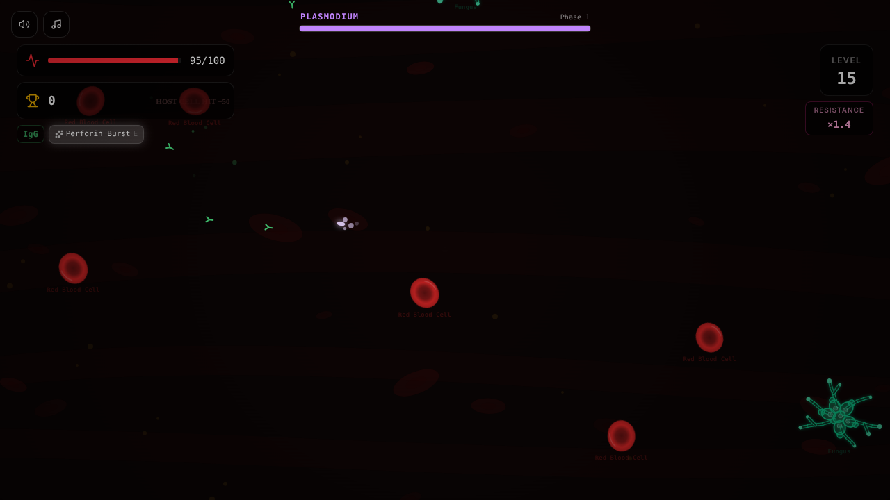 | 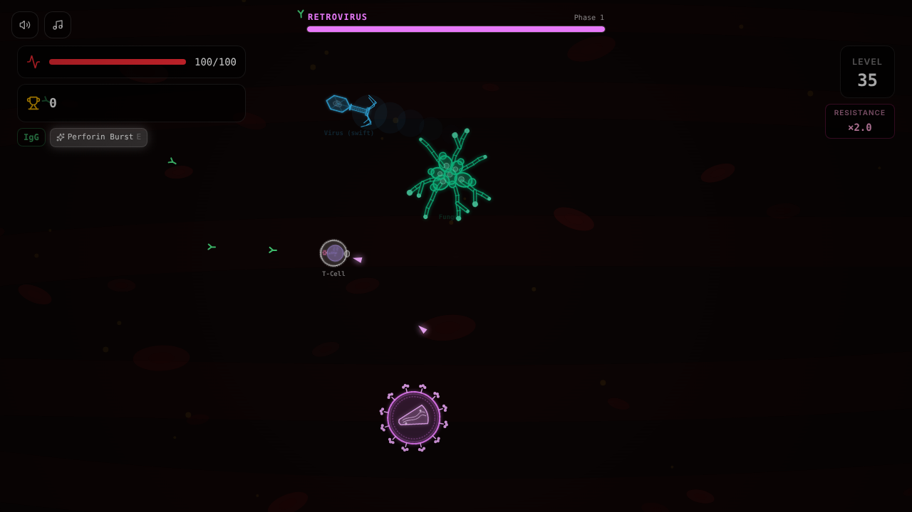 |
| **Plasmodium**: hides inside red blood cells | **Retrovirus**: infects you and hijacks T-cells |
| 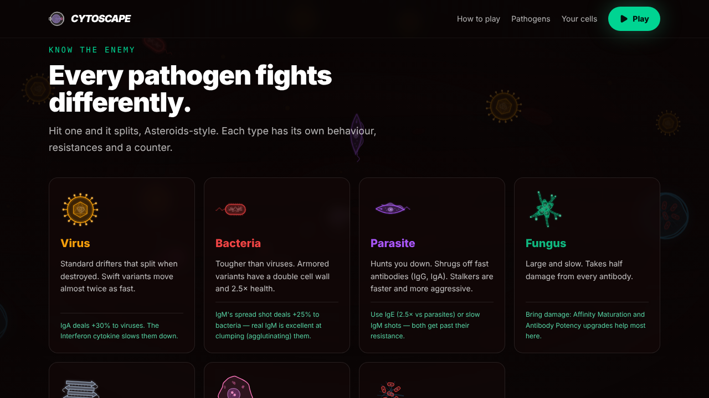 | 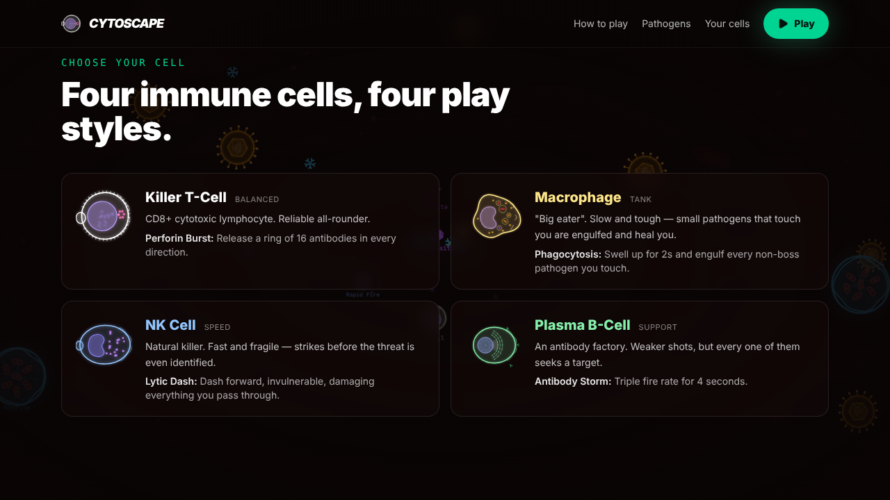 |
| **Know the enemy**: every pathogen has a counter | **Four playable immune cells** |

<p align="center">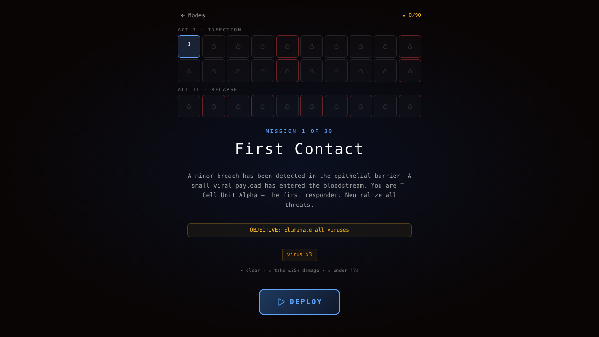<br /><b>Campaign</b>: 30 missions across two acts</p>

## About

Cytoscape: Immune Defense is a fast-paced, browser-based arcade game inspired by classic Asteroids. You pilot a white blood cell through a microscopic battlefield, firing antibodies at viruses, bacteria, parasites and fungi. Each pathogen has its own behaviour, resistances and variants, so every fight asks a different question.

Everything in the game is drawn from real immunology: antibody classes really do favour different targets, macrophages really do engulf pathogens, Plasmodium really does hide inside red blood cells, and the final boss is an autoimmune T-cell, one of your own turned against the body. A codex unlocks the biology behind each enemy as you defeat it.

The game is made by [Jeremy Anderson Tech](https://jeremyanderson.tech/), a web development and security practice in Shrewsbury, MA. Read more on the [project page](https://jeremyanderson.tech/project/cytoscape-immune-defense/).

| | |
|---|---|
| **Genre** | Arcade shooter / roguelite |
| **Platforms** | Any modern browser; installable as an app on Android, iOS, Windows, macOS and Linux |
| **Input** | Keyboard or touchscreen |
| **Price** | Free, [donations welcome](https://cptnope.itch.io/cytoscape-immune-defense/donate) |
| **Source** | Open source, [Apache-2.0](LICENSE) |
| **Current version** | 2.3.2 ([changelog](CHANGELOG.md)) |

## Where to play

| | Link | Best for |
|---|---|---|
| **itch.io** | [cptnope.itch.io/cytoscape-immune-defense](https://cptnope.itch.io/cytoscape-immune-defense) | Playing in the page, ratings and comments, donating |
| **Web app (GitHub Pages)** | [cptnope.github.io/Cytoscape-Immune-Defense](https://cptnope.github.io/Cytoscape-Immune-Defense/) | Installing as an app and playing offline; always the newest build from `main` |
| **Project page** | [jeremyanderson.tech/project/cytoscape-immune-defense](https://jeremyanderson.tech/project/cytoscape-immune-defense/) | The story behind the game |

Progress is saved in your browser on each site separately (itch.io and GitHub Pages don't share saves).

### Installing the web app

| Device | How |
|---|---|
| **iPhone / iPad (Safari)** | Share → Add to Home Screen |
| **Android (Chrome)** | Tap the install banner, or Menu → Install app |
| **Desktop (Chrome / Edge)** | Click the install icon in the address bar |

## Features

- **7 pathogen types**: viruses, bacteria, parasites, fungi, prions, cancer cells and biofilms, with swift, armoured and stalker variants
- **9 bosses** with telegraphed attacks and phases: Mega Virus, Bacterial Colony, Parasitic Worm, Fungal Bloom, Plasmodium, Retrovirus, Influenza, Metastatic Tumor and the Autoimmune T-Cell
- **4 playable cells**, each with its own ability: Killer T-Cell, Macrophage, NK Cell and Plasma B-Cell
- **4 antibody classes** (IgG, IgM, IgA, IgE) to swap mid-run against different targets
- **Roguelite runs**: pick 1 of 3 mutations after every wave (clonal selection)
- **Permanent progression**: XP, 5 upgrade tracks to level 10, cytokine loadout, immune memory, cosmetic membranes
- **4 modes**: Endless, a 30-mission Campaign with star ratings, Time Attack and Zen
- **Codex** of real biology for every pathogen and boss
- **Adaptive resistance** keeps the challenge fair as you get stronger
- **Touch controls, haptics, colourblind palette** (Okabe–Ito, every entity also has a shape and label), audio and music controls
- **Runs well everywhere**: fixed-timestep simulation, render interpolation, automatic quality and entity budgets for low-end phones
- **Installable PWA** that works offline

The full reference, with every number, is in the **[gameplay guide](docs/GAMEPLAY.md)**.

## How to play

### Controls

| Action | Keyboard | Touch |
|--------|----------|-------|
| **Move** | `WASD` / arrow keys | Drag anywhere on the left half |
| **Fire** | `Space` or `F` | Hold anywhere on the right half |
| **Cell ability** | `E` or `Shift` | ✦ button |
| **Switch antibody class** | `Q` or `Tab` | ⇄ button |
| **Pause** | `Esc` | Pause button |

### The loop

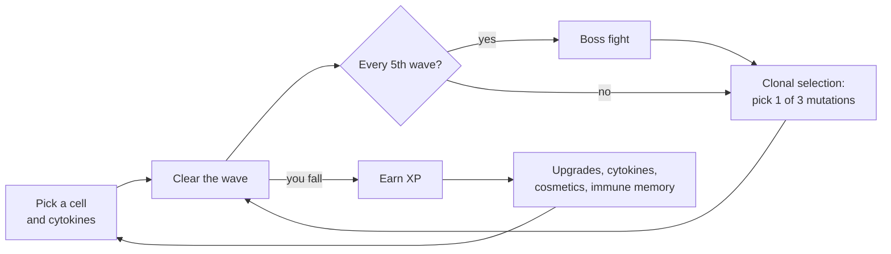

Shoot a pathogen and it splits into smaller copies, Asteroids-style, until the pieces are too small to split. Destroyed pathogens have a 15% chance to drop a power-up: Rapid Fire, Shield, Damage Boost or System Purge.

### Pathogens at a glance

| Pathogen | Behaviour | Best counter |
|---|---|---|
| **Virus** | Splits and swarms; *swift* variant moves almost twice as fast | IgA (+30% vs viruses) |
| **Bacteria** | Tougher; *armoured* variant has a double cell wall | IgM (+25% vs bacteria) |
| **Parasite** | Hunts you; *stalker* variant is faster and more aggressive | IgE (2.5× vs parasites) or IgM; dodges fast shots |
| **Fungus** | Large, slow, takes half damage | Raw damage: Affinity Maturation, Antibody Potency |
| **Prion** | Tiny, fast, nearly invisible swarms | IgA pierces the cluster; Multi-Epitope covers the swarm |
| **Cancer cell** | Grows and copies itself | Kill it early |
| **Biofilm** | Shielded colony; break the shell first | IgM (+25% vs biofilm shields) |

### Game modes

| Mode | Goal |
|---|---|
| **Endless** | Survive as long as you can; a boss every 5 waves, cycling through all nine and getting tougher each loop |
| **Campaign** | 30 story missions in two acts (*Infection* and *Relapse*), each with 3 stars to earn |
| **Time Attack** | 60 seconds on the clock; every kill adds time |
| **Zen** | No damage, no score; drift through the bloodstream |

## Documentation

| Document | What's in it |
|---|---|
| [docs/GAMEPLAY.md](docs/GAMEPLAY.md) | Complete reference: pathogens, bosses, cells, antibodies, mutations, cytokines, upgrades, power-ups, modes, saves |
| [docs/ARCHITECTURE.md](docs/ARCHITECTURE.md) | How the code fits together: engine modules, game loop, rendering, performance, tests |
| [docs/DEPLOYMENT.md](docs/DEPLOYMENT.md) | GitHub Pages, the itch.io build, butler uploads, PWA updates and the release checklist |
| [itch/STORE_PAGE.md](itch/STORE_PAGE.md) | The itch.io store page: copy, settings, theme, images |
| [CONTRIBUTING.md](CONTRIBUTING.md) | How to set up, test and send a pull request |
| [CHANGELOG.md](CHANGELOG.md) | Every release since 1.0 |
| [ROADMAP.md](ROADMAP.md) | What's done and what's next |

## Tech stack

| Technology | Purpose |
|------------|---------|
| [React 19](https://react.dev/) | UI: menus, overlays, HUD |
| [TypeScript 5.8](https://www.typescriptlang.org/) | Type safety across the engine and UI |
| [Vite 6](https://vite.dev/) | Dev server and builds |
| [Tailwind CSS 4](https://tailwindcss.com/) | Styling |
| [Motion](https://motion.dev/) | UI and landing page animation |
| [Lucide](https://lucide.dev/) | Icons |
| HTML5 Canvas 2D | Game rendering; all art is procedural SVG drawn by the game |
| Web Audio API | Synthesised sound effects and music |
| [vite-plugin-pwa](https://vite-pwa-org.netlify.app/) + Workbox | Service worker, manifest, offline caching |
| [Vitest](https://vitest.dev/) | Unit tests for the engine (200 tests) |
| GitHub Actions | CI, GitHub Pages deploys, itch.io builds |

## Architecture at a glance

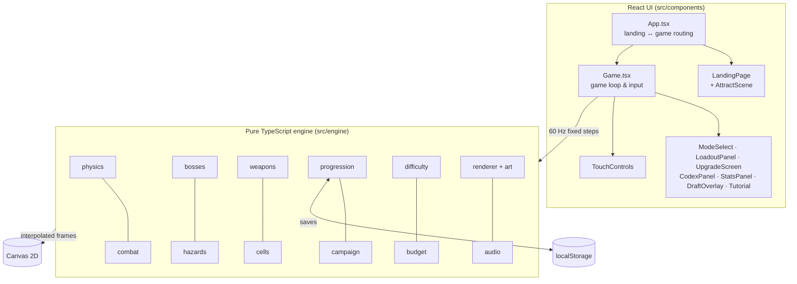

The engine is plain TypeScript with no React in it, so the rules (collisions, damage, boss AI, progression) are unit-tested headlessly. See [docs/ARCHITECTURE.md](docs/ARCHITECTURE.md) for the details.

## Development

**Prerequisites:** Node.js 22 (20.15+ works).

```bash
git clone https://github.com/CptNope/Cytoscape-Immune-Defense.git
cd Cytoscape-Immune-Defense
npm install
npm run dev        # http://localhost:3000/Cytoscape-Immune-Defense/
```

| Command | Description |
|---------|-------------|
| `npm run dev` | Dev server on port 3000 with hot reload |
| `npm run build` | GitHub Pages build to `dist/` (PWA, landing page) |
| `npm run build:itch` | itch.io build to `dist-itch/` and a ready-to-upload zip in `release/` |
| `npm run preview` | Serve the production build locally |
| `npm test` | Run the unit tests |
| `npm run test:watch` | Tests in watch mode |
| `npm run lint` | Type-check with `tsc` |
| `npm run generate-icons` | Regenerate every PWA icon from `public/icon.svg` |
| `npm run clean` | Remove `dist/`, `dist-itch/` and `release/` |

In development, `window.__cytoDebug` exposes entity counts and `jumpToWave(n)` for testing bosses and stress (it's stripped from production builds).

### Project structure

```
├── .github/
│   ├── FUNDING.yml           # "Sponsor" button → itch.io donations
│   └── workflows/            # ci.yml, deploy.yml (Pages), itch.yml, preview-cleanup.yml
├── docs/                     # Gameplay, architecture and deployment guides + images
├── itch/                     # itch.io store page kit: copy, cover, banner, screenshots
├── public/                   # icon.svg, generated icons, favicon
├── scripts/
│   ├── generate-icons.mjs    # PWA icons from icon.svg (sharp)
│   └── package-itch.mjs      # Zips dist-itch/ for itch.io and checks its limits
├── src/
│   ├── App.tsx               # Landing page ↔ game routing (#play)
│   ├── components/           # React UI: Game, LandingPage, menus, overlays, touch controls
│   ├── engine/               # Game rules, AI, rendering, audio, progression (+ __tests__)
│   └── pwa-register-stub.ts  # No-op service worker hook for the itch build
├── index.html
├── vite.config.ts            # Pages and itch build modes, PWA config
├── CHANGELOG.md · ROADMAP.md · CONTRIBUTING.md · LICENSE
└── package.json
```

## Deployment

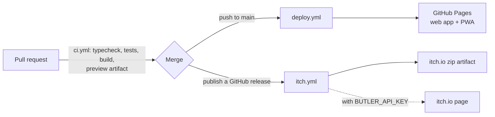

- **GitHub Pages** deploys automatically on every push to `main`. Installed copies of the app show an "Update available" prompt.
- **itch.io** gets a separate build with relative paths and no service worker. Publishing a GitHub release builds the zip; with the `BUTLER_API_KEY` secret and `ITCH_GAME` variable set, it's pushed to itch automatically. Otherwise upload the zip from the workflow run.

Full steps, including the release checklist, are in [docs/DEPLOYMENT.md](docs/DEPLOYMENT.md).

## Support the game

Cytoscape is free and always will be. If you enjoy it, you can:

- **[Donate on itch.io](https://cptnope.itch.io/cytoscape-immune-defense/donate)**: name your own amount; it goes straight to development
- **Rate it or leave a comment** on the [itch.io page](https://cptnope.itch.io/cytoscape-immune-defense)
- **Star this repo** and share the game with someone who likes biology or arcade games
- **[Report a bug or suggest an idea](https://github.com/CptNope/Cytoscape-Immune-Defense/issues)**

## Contributing

Ideas, bug reports and pull requests are welcome. Read [CONTRIBUTING.md](CONTRIBUTING.md) for setup and conventions, and check the [roadmap](ROADMAP.md) for planned work. For anything big, open an [issue](https://github.com/CptNope/Cytoscape-Immune-Defense/issues) first so we can talk through the approach.

## Credits

- Design and development: [Jeremy Anderson Tech](https://jeremyanderson.tech/) ([services](https://jeremyanderson.tech/services/))
- Built with help from Claude (Anthropic); code, art, text and audio include AI-assisted work, as disclosed on itch.io
- Fonts: [Inter](https://rsms.me/inter/) and [JetBrains Mono](https://www.jetbrains.com/lp/mono/) via Google Fonts
- Inspired by Atari's *Asteroids* (1979) and a lot of immunology textbooks

## License

Licensed under the [Apache License 2.0](LICENSE).

---

<p align="center">Built by <a href="https://jeremyanderson.tech/">Jeremy Anderson Tech</a> · Shrewsbury, MA · <a href="https://cptnope.itch.io/cytoscape-immune-defense/donate">Support the game ♥</a></p>
