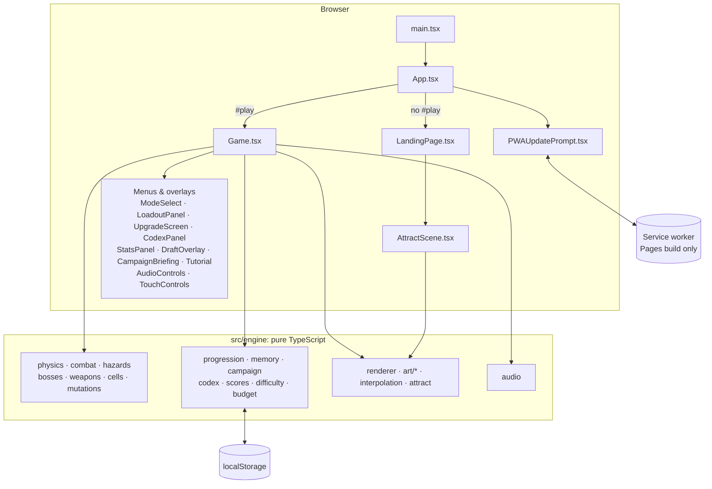
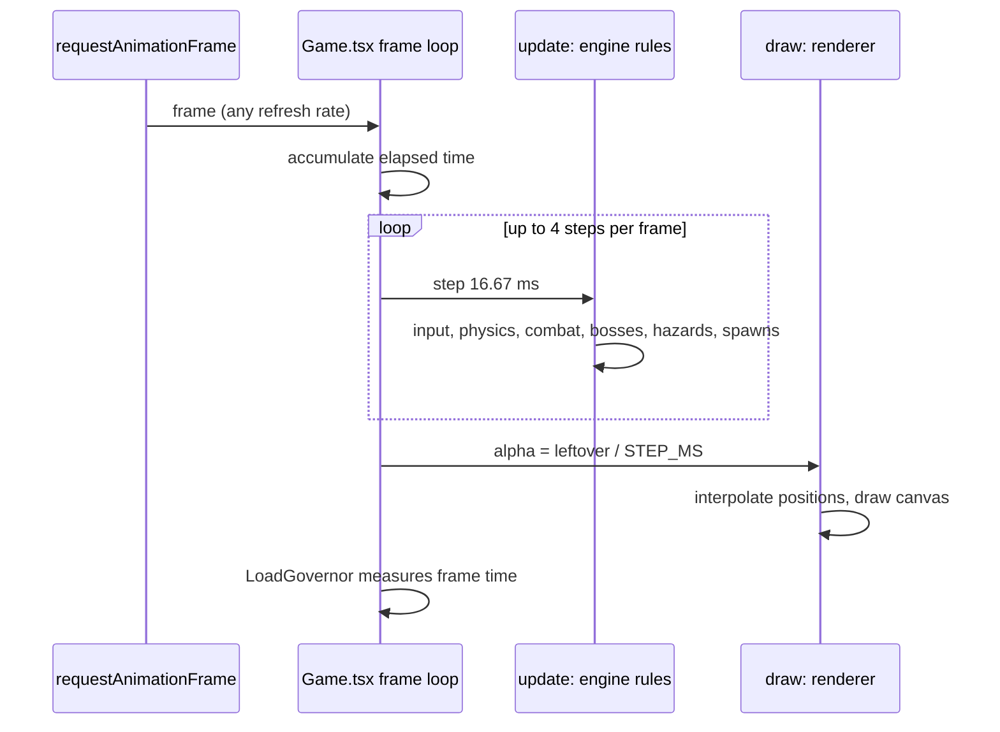

# Architecture

How Cytoscape: Immune Defense is put together, for anyone reading or changing the code.

[← Back to the README](../README.md) · [Gameplay guide](GAMEPLAY.md) · [Deployment](DEPLOYMENT.md) · [Contributing](../CONTRIBUTING.md)

## Overview

The game is a single-page React app, but React only handles the menus, overlays and HUD. The game itself runs on a `<canvas>` driven by a pure TypeScript **engine** in `src/engine/`. The engine has no React in it, so its rules are unit-tested without a browser.

## Routing

`App.tsx` switches between two views using the URL hash:

- No hash: the **landing page** (`LandingPage.tsx`), with the game playing itself behind it (`AttractScene.tsx` + `engine/attract.ts`)
- `#play`: the **game** (`Game.tsx`)

Back and forward work, and `#play` links skip the intro. If you press Back during a run, the game stays put instead of throwing the run away. The itch.io build (`__ITCH__`) opens straight on the game, since itch's store page does the introducing.

## The game loop

`Game.tsx` owns the loop. The simulation runs on a **fixed 60 Hz timestep** (`STEP_MS = 1000 / 60`), decoupled from the display's refresh rate:

- **Fixed steps** keep the game identical on 60, 120 and 144 Hz screens. At most 4 steps run per frame, so a slow frame can't spiral.
- **Interpolation** (`interpolation.ts`) draws entities between their previous and current positions, so motion stays smooth on high-refresh displays.
- **Game state lives in refs**, not React state, so the loop never triggers React re-renders. React only re-renders for menus and HUD changes.

## Engine modules

| Module | Responsibility |
|---|---|
| `types.ts` | Every shared interface: vectors, entities, pathogens, bosses, profile |
| `constants.ts` | Physics and balance numbers, upgrade/cytokine/cosmetic definitions, XP thresholds |
| `physics.ts` | Pure helpers: velocity, screen wrap, collisions |
| `combat.ts` | Damage rules: class bonuses, resistances, armour, biofilm shields, immune memory |
| `weapons.ts` | Antibody classes IgG, IgM, IgA, IgE |
| `cells.ts` | Playable cells, their stats and abilities |
| `mutations.ts` | Clonal selection: the 12 mutations and the weighted draft |
| `hazards.ts` | Enemy projectiles, spore clouds, telegraphs, inflammation rings |
| `bosses.ts` | All 9 bosses: AI, attacks, phases, the Endless rotation |
| `difficulty.ts` | Adaptive resistance: estimates player power, scales enemy threat |
| `budget.ts` | Entity caps by quality, reinforcement queues, the load governor |
| `progression.ts` | XP, levels, upgrades, loadout, cosmetics, respec, save/load |
| `memory.ts` | Immune memory thresholds and bonuses |
| `campaign.ts` | 30 missions, objectives, par times, stars |
| `codex.ts` | Biology text and tips for every pathogen and boss |
| `scores.ts` | Top-10 score table |
| `renderer.ts` | Canvas drawing for the background, entities, effects, HUD layers |
| `art/` | Procedural SVG artwork, sprite cache, motion and painters (below) |
| `attract.ts` | The self-playing landing-page scene |
| `audio.ts` | Web Audio synthesis for effects and music, volume settings, haptics |
| `index.ts` | Barrel re-exports |

## Rendering and art

All art is generated by code; there are no image files for the game itself.

- `art/organisms.ts` describes every cell, microbe and boss as SVG, based on real biology (capsids, cell walls, organelles, flagella).
- `art/sprites.ts` rasterises each organism's **static** detail once into an offscreen canvas, keyed by art, variant, colours and size bucket. Drawing it is a single `drawImage`, which is far cheaper on mobile GPUs than stroking dozens of paths every frame.
- `art/painter.ts` provides one drawing interface with two back ends: the canvas (for animated parts like membranes and flagella, drawn every frame without allocations) and SVG markup (so the same drawing code also produces the static artwork used in menus and on the landing page via `OrganismArt.tsx`).
- `art/motion.ts` adds purely visual motion: spring pop-in, turning towards travel direction, stretch with speed and squash on hit. It never touches the simulation.

## Performance

The game is built to stay smooth on low-end phones:

| Technique | Where |
|---|---|
| Render quality **High / Low** (Low drops canvas shadow glows, the most expensive mobile GPU operation) | `renderer.ts`, auto-detected in `Game.tsx` |
| **Entity caps** per quality (e.g. 70 vs 45 pathogens, 200 vs 90 particles) | `budget.ts` |
| **Reinforcements**: waves bigger than the cap queue the rest and stream them in as you kill | `budget.ts`, `Game.tsx` |
| **Load governor**: if frames get slow, caps shrink automatically, and grow back when things recover | `budget.ts` (`LoadGovernor`) |
| **Sprite cache** for static art | `art/sprites.ts` |
| In-place array compaction instead of `filter()` each frame | `interpolation.ts` |

## Persistence

Everything is saved to `localStorage`, and every read and write is wrapped in `try/catch` so the game keeps working where storage is blocked (some embedded iframes and private modes).

| Key | Contents |
|---|---|
| `cytoscape-player-profile` | XP, upgrades, cell, cytokines, cosmetics, immune memory, stats |
| `cytoscape-top-scores` | Top 10 scores |
| `cyto-campaign-progress`, `cyto-campaign-stars` | Campaign unlocks and star ratings |
| `cyto-render-quality`, `cyto-colorblind`, `cytoscape-audio-settings` | Settings |
| `cyto-tutorial-done` | Whether the first-run tutorial was shown |

Profiles from older versions are merged with defaults when loaded, so updates never wipe progress.

## Build variants

`vite.config.ts` produces two builds from the same code:

| | GitHub Pages (`npm run build`) | itch.io (`npm run build:itch`) |
|---|---|---|
| Base path | `/Cytoscape-Immune-Defense/` | `./` (relative, for itch's CDN) |
| Service worker / install prompt | Yes (vite-plugin-pwa, Workbox) | No (`pwa-register-stub.ts`) |
| Opens on | Landing page | Game menu |
| Output | `dist/` | `dist-itch/` + zip in `release/` |
| Flag | `__ITCH__ = false` | `__ITCH__ = true` |

See [DEPLOYMENT.md](DEPLOYMENT.md) for how each is shipped.

## Tests

`npm test` runs the Vitest suite in `src/engine/__tests__/` (200 tests):

| File | Covers |
|---|---|
| `physics.test.ts` | Movement, wrapping, collisions |
| `systems.test.ts` | Combat, immune memory, clonal selection, antibody classes, cells, campaign, codex |
| `bosses.test.ts` | Every boss's phases and attacks, the Endless rotation |
| `difficulty.test.ts` | Power estimates and threat scaling |
| `progression.test.ts` | XP, upgrades, loadout, saves, migration of old profiles |
| `scores.test.ts` | Score table |
| `interpolation.test.ts` | Interpolation and compaction |
| `art.test.ts` | Artwork and sprite cache |
| `attract.test.ts` | The landing-page scene |

CI runs type-checking, tests and a build on every pull request.

## Development hooks

In `npm run dev` only, `window.__cytoDebug` exposes:

- `counts()`: live entity counts, caps, load scale, frame time, threat and health
- `jumpToWave(n)`: skip to any wave, e.g. `jumpToWave(25)` for the Influenza boss

These are stripped from production builds.
