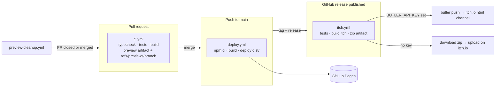

# Deployment

Cytoscape ships to two places from the same code: **GitHub Pages** (the installable web app) and **itch.io** (the store page with the in-page embed and donations).

[← Back to the README](../README.md) · [Architecture](ARCHITECTURE.md) · [itch.io store page kit](../itch/STORE_PAGE.md)

| | GitHub Pages | itch.io |
|---|---|---|
| **URL** | https://cptnope.github.io/Cytoscape-Immune-Defense/ | https://cptnope.itch.io/cytoscape-immune-defense |
| **Build** | `npm run build` → `dist/` | `npm run build:itch` → `dist-itch/` + `release/*.zip` |
| **Updates when** | Every push to `main` (automatic) | A GitHub release is published (automatic with butler) or you upload a zip |
| **Offline / install** | Yes (service worker, manifest) | No (itch hosts it in an iframe) |
| **Opens on** | Animated landing page | Game menu |

## Workflows



| Workflow | Trigger | What it does |
|---|---|---|
| `ci.yml` | Pull requests, pushes to branches other than `main` | Type-check, unit tests, build; on PRs uploads the built site as an artifact and to a hidden `refs/previews/<branch>` ref |
| `deploy.yml` | Push to `main`, or run by hand | Builds and deploys `dist/` to GitHub Pages |
| `itch.yml` | GitHub release published, or run by hand | Tests, builds the itch zip, uploads it as an artifact, and pushes with butler if configured |
| `preview-cleanup.yml` | Pull request closed or merged | Removes that pull request's preview ref |

## GitHub Pages

Nothing to do: merging to `main` deploys. The site is served from `/Cytoscape-Immune-Defense/`, which is why the Pages build uses that base path.

**How players get updates:** the service worker checks for a new version every 60 seconds. When one is ready, an **Update available** prompt appears; tapping **Update** reloads into the new version. The version shown in the game comes from `package.json`.

Pages settings (already configured): Settings → Pages → Source: **GitHub Actions**.

## itch.io

### What's different about the itch build

`vite build --mode itch` (run by `npm run build:itch`):

- uses **relative paths**, because itch serves the game from its own CDN folder (`html-classic.itch.zone/html/<id>/`), where `/Cytoscape-Immune-Defense/` paths would 404
- has **no service worker** or update prompt; a service worker inside itch's iframe would keep serving old builds after you upload a new one
- opens on the **game menu**; "About the game" still shows the landing page

`scripts/package-itch.mjs` then zips `dist-itch/` with `index.html` at the root and fails the build if itch's limits are broken (1,000 files, 500 MB) or if an absolute path or `sw.js` slipped in.

### Automatic uploads with butler

1. Create an API key at https://itch.io/user/settings/api-keys
2. In this repo: **Settings → Secrets and variables → Actions**
   - Secret **`BUTLER_API_KEY`**: the key
   - Variable **`ITCH_GAME`**: `cptnope/cytoscape-immune-defense`
3. Publish a GitHub release. `itch.yml` pushes the build to the `html` channel, tagged with the version from `package.json`.

The first time butler pushes, open the upload on itch and tick **This file will be played in the browser** for the `html` channel, then remove the older manually uploaded zip.

### Manual upload

1. `npm run build:itch` (or download the zip artifact from the **itch.io build** workflow run)
2. On itch: **Edit game → Uploads**, upload `release/cytoscape-immune-defense-itch-v<version>.zip`
3. Tick **This file will be played in the browser**, delete the old zip, save

### itch page settings

The current page setup (embed size, theme, tags, links, AI disclosure, pricing) is recorded in [itch/STORE_PAGE.md](../itch/STORE_PAGE.md), with the cover, banner and screenshots in `itch/`.

## Release checklist

1. Make your changes on a branch and open a pull request; wait for CI
2. Bump `version` in `package.json` (and `package-lock.json` via `npm install --package-lock-only`)
3. Add a dated entry to [CHANGELOG.md](../CHANGELOG.md) and update the version badge in the README
4. Merge to `main`: GitHub Pages deploys and installed apps get the update prompt
5. Create a GitHub release with tag `v<version>` and the changelog entry as notes: the itch build runs
6. Post a devlog on itch.io for bigger updates, so followers hear about it
7. Play a quick run on both sites (keyboard and phone)

## Local preview

```bash
npm run build && npm run preview          # Pages build at http://localhost:4173/Cytoscape-Immune-Defense/
npm run build:itch                        # then serve dist-itch/ from any static server
```
