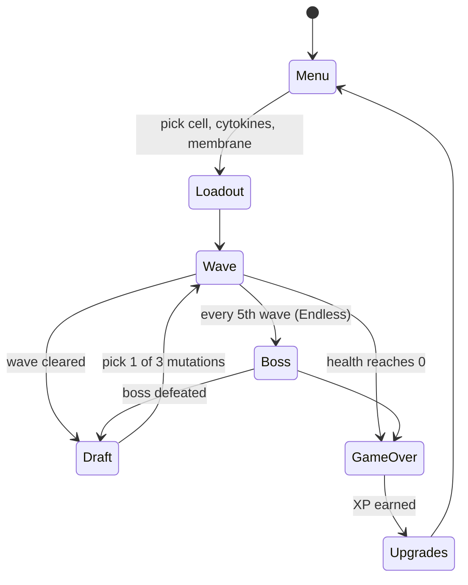
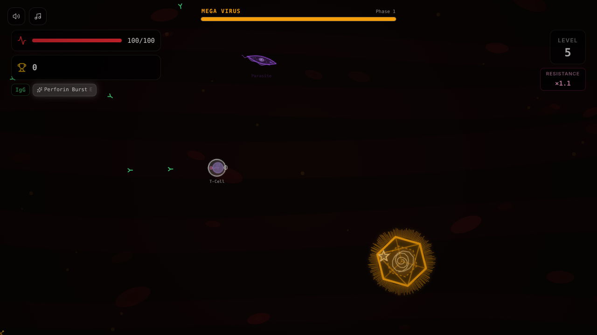
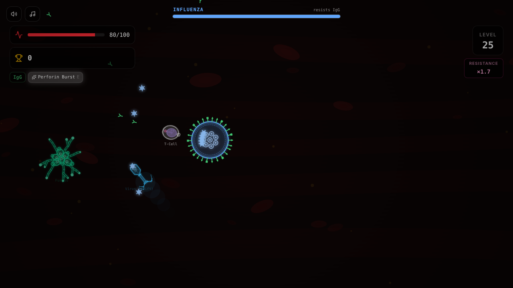
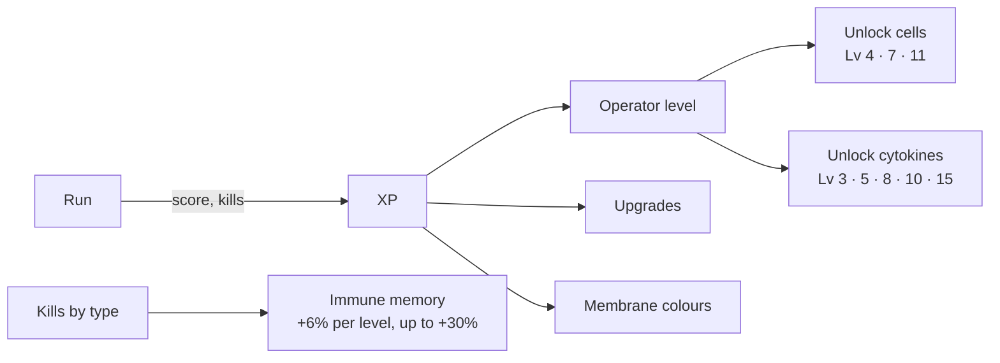
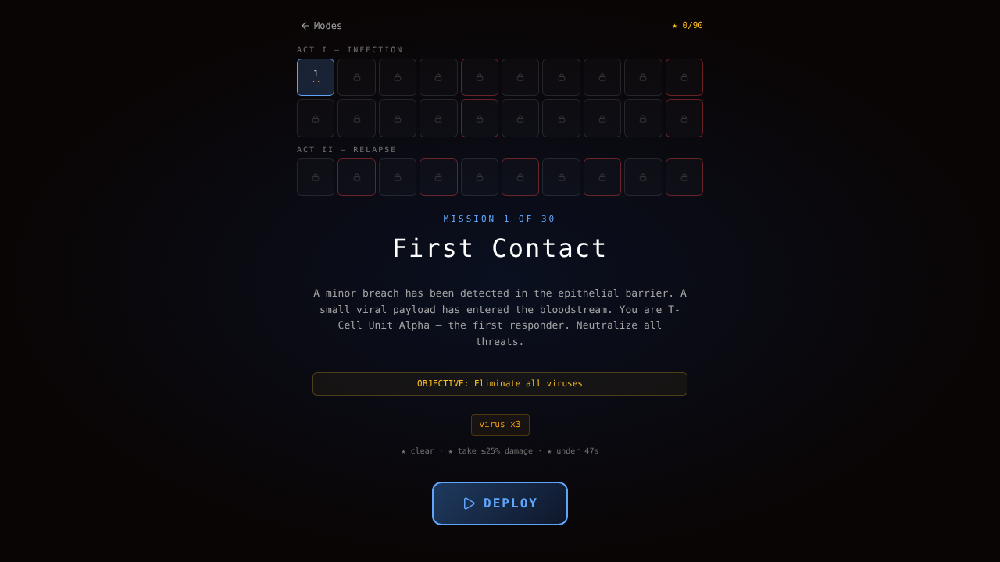

# Gameplay guide

The complete reference for **Cytoscape: Immune Defense**. Numbers here come straight from the game's code (`src/engine/`), so they match what you'll see in play.

[← Back to the README](../README.md) · [Play on itch.io](https://cptnope.itch.io/cytoscape-immune-defense) · [Play the web app](https://cptnope.github.io/Cytoscape-Immune-Defense/)

## Contents

- [Controls](#controls)
- [How a run works](#how-a-run-works)
- [Pathogens](#pathogens)
- [Bosses](#bosses)
- [Playable cells](#playable-cells)
- [Antibody classes](#antibody-classes)
- [Clonal selection (mutations)](#clonal-selection-mutations)
- [Power-ups](#power-ups)
- [Permanent progression](#permanent-progression)
- [Game modes](#game-modes)
- [Difficulty and adaptive resistance](#difficulty-and-adaptive-resistance)
- [Settings and accessibility](#settings-and-accessibility)
- [Saves](#saves)

## Controls

| Action | Keyboard | Touch |
|--------|----------|-------|
| Move (thrust and turn) | `W` / `↑` thrust, `A` `D` / `←` `→` turn | Drag anywhere on the left half of the screen |
| Fire | `Space` or `F` | Hold anywhere on the right half |
| Cell ability | `E` or `Shift` | ✦ button |
| Switch antibody class | `Q` or `Tab` | ⇄ button |
| Pause | `Esc` | Pause button |

The first run shows a short **field training** tutorial; you can replay it from the main menu. On phones, damage and power-ups trigger haptic feedback.

## How a run works

- Clear every pathogen to finish a wave. Each wave brings more enemies, moving faster.
- Big waves stream in as reinforcements once the screen is full, so the game stays smooth on every device.
- Shoot a pathogen and it **splits** into two smaller ones, Asteroids-style, until the pieces are too small.
- Everything **wraps** around the screen edges, including you.
- Each wave ends with **clonal selection**: pick one of three mutations to power up the rest of the run.

## Pathogens

| Pathogen | Behaviour | Variants | Counter |
|---|---|---|---|
| **Virus** | Standard drifter that splits when destroyed | *Swift*: almost twice as fast | IgA (+30%); the Interferon cytokine slows them |
| **Bacteria** | Tougher, 2.5× health | *Armoured*: double cell wall | IgM spread shot (+25%) |
| **Parasite** | Tracks you; shrugs off fast antibodies (IgG, IgA) | *Stalker*: faster, more aggressive homing | IgE (2.5×) or slow IgM shots |
| **Fungus** | Large, slow, branching spores; takes half damage | | Damage: Affinity Maturation and Antibody Potency |
| **Prion** | Tiny, fast and nearly invisible; comes in swarms | | IgA pierces clusters; Multi-Epitope covers the swarm |
| **Cancer cell** | Grows over time and copies itself | | Kill it early; it gets tougher as it grows |
| **Biofilm** | Shielded colony; the shield soaks every hit until it breaks | | IgM (+25% vs biofilm shields) |

Prions, cancer cells and biofilms appear in later waves. Each pathogen also has a **codex** entry with the real biology behind it, unlocked when you kill one.

## Bosses

In **Endless** mode a boss appears every 5 waves, in this order, and the cycle repeats tougher each loop. The **Campaign** introduces them through its story.

| Wave | Boss | Mechanics | How to beat it |
|---|---|---|---|
| 5 | **Mega Virus** | Shielded capsid fires virion rings; splits off swift viruses at half health | Dodge the rings while it's shielded (3 s), unload while it's vulnerable |
| 10 | **Bacterial Colony** | Core is protected while 3+ segments remain; breaking a link fragments the chain | Shoot segments near the head to break off the whole tail |
| 15 | **Plasmodium** | Hides inside red blood cells; don't shoot the healthy ones | Watch for the ring-stage pulse, hit that cell 3 times, strike the exposed parasite |
| 20 | **Parasitic Worm** | Armoured body deflects shots; burrows, then lunges along a telegraphed line | Only the head takes damage; step off the purple line |
| 25 | **Influenza** | Antigenic shift: resists one antibody class at a time | Watch which class it resists and switch (`Q` / ⇄) |
| 30 | **Fungal Bloom** | Hyphae armour and heal the core; spore clouds slow and damage you | Cut all four hyphae, then burst the core before they regrow |
| 35 | **Retrovirus** | Infects you (slower fire), hijacks T-cells, goes latent to heal | Using your ability or grabbing a power-up purges the infection |
| 40 | **Metastatic Tumor** | Blood vessels armour it; seeds new tumours across the tissue | Cut the vessels first; shoot seeds before they land |
| 45 | **Autoimmune T-Cell** | Final boss: mirrors you, fires back, triggers cytokine-storm rings | Fly through the gap in each inflammation ring |

Bosses take only 20% damage from System Purge, and the **Antigen Presentation** mutation adds +25% damage against them.

## Playable cells

Pick your cell in the **Loadout** panel. Each has an active ability on `E` / `Shift` / ✦.

| Cell | Role | Unlocks at | Trait | Ability |
|---|---|---|---|---|
| **Killer T-Cell** | Balanced | Level 1 | CD8+ cytotoxic lymphocyte; reliable all-rounder | **Perforin Burst**: a ring of 16 antibodies in every direction |
| **Macrophage** | Tank | Level 4 | Slow and tough; small pathogens that touch you are engulfed and heal you | **Phagocytosis**: swell up for 2 s and engulf every non-boss pathogen you touch |
| **NK Cell** | Speed | Level 7 | Fast and fragile | **Lytic Dash**: dash forward, invulnerable, damaging everything you pass through |
| **Plasma B-Cell** | Support | Level 11 | Weaker shots, but every one seeks a target | **Antibody Storm**: triple fire rate for 4 s |

## Antibody classes

Switch class any time with `Q` / `Tab` / ⇄. Matching the class to the target is the biggest damage multiplier in the game.

| Class | Shot | Strong against |
|---|---|---|
| **IgG** | Standard antibody, balanced speed and damage | Everything, nothing in particular |
| **IgM** | Slow pentamer spread shot; parasites can't dodge it | Bacteria (+25%), biofilm shields (+25%), parasites |
| **IgA** | Fast, piercing; passes through 2 targets | Viruses (+30%), prion swarms |
| **IgE** | Heavy, slow shot | Parasites (2.5×) |

## Clonal selection (mutations)

After each wave, pick 1 of 3 mutations. They last for the rest of the run and some stack.

| Mutation | Effect | Max stacks |
|---|---|---|
| 🎯 Affinity Maturation | +15% antibody damage | 3 |
| 🧫 Clonal Expansion | 12% faster fire rate | 3 |
| 🔱 Multi-Epitope | Fire 2 extra side antibodies (60% damage) | 2 |
| 🗡️ Piercing Fab | Antibodies pass through 1 more target | 2 |
| 🏷️ Opsonization | Hits tag pathogens: +30% damage taken for 3 s | 1 |
| 💫 Complement Cascade | Kills burst into 6 antibody fragments | 1 |
| 🛰️ NK Escort | An NK cell orbits you and fires at the nearest pathogen | 2 |
| ❤️‍🩹 Membrane Repair | +20 max health and fully heal | 5 |
| 🎓 Thymic Training | −30% contact damage, longer invulnerability after hits | 2 |
| 💡 Memory Recall | +7% power-up drop chance | 2 |
| ⏱️ Interleukin-2 | Ability cooldown 25% shorter | 2 |
| 👑 Antigen Presentation | +25% damage vs bosses | 2 |

## Power-ups

Destroyed pathogens have a **15%** chance to drop a power-up (more with Memory Recall). Uncollected power-ups disappear after 10 seconds.

| Power-up | Effect | Duration |
|---|---|---|
| **Rapid Fire** | Faster shot rate | 5 s |
| **Shield** | Absorbs damage and bounces pathogens away | 5 s (longer with Membrane Shield upgrades) |
| **Damage Boost** | Double antibody damage | 5 s |
| **System Purge** | Destroys every pathogen on screen; bosses take 20% damage | Instant |

## Permanent progression

Every run earns **XP**, which raises your **operator level** (up to 20) and is spent on upgrades.

### Upgrades

Five tracks, each up to level 10. Gains shrink after level 5. You can **respec** for free.

| Upgrade | Per level | Cost (Lv 1 → 10) |
|---|---|---|
| 🛡️ Hull Integrity | +10 max health | 100 → 12,500 XP |
| 🚀 Thruster Power | +0.02 thrust (+0.01 after Lv 5) | 100 → 12,500 XP |
| ⚔️ Antibody Potency | +0.25 damage (+0.15 after Lv 5) | 150 → 16,000 XP |
| ⚡ Rapid Response | −15 ms shot delay (−6 ms after Lv 5) | 150 → 16,000 XP |
| 🔮 Membrane Shield | +50 frames shield duration | 200 → 16,000 XP |

### Cytokines

Passive signals. Equip up to **2** in the Loadout panel.

| Cytokine | Unlocks at | Effect |
|---|---|---|
| Interferon | Level 3 | Viruses and enemy projectiles move 25% slower |
| Auto-Targeting | Level 5 | Antibodies gently track the nearest pathogen |
| Fever | Level 8 | Every 3 s, a heat pulse damages pathogens near you |
| Regeneration | Level 10 | Slowly recover health over time |
| Chain Reaction | Level 15 | Explosions damage nearby pathogens |

### Immune memory

Killing enough of one pathogen type gives permanent bonus damage against it: **+6% per memory level**, reached at 20, 60, 150, 300 and 600 kills (up to +30%). Track it in the **Codex**.

### Cosmetics

Buy membrane colours with XP: Cytoplasm Cyan (2,000), Chlorophyll Lime (3,000), Lysosome Violet (4,000), Golden Helix (6,000) and Hemoglobin Rose (8,000).

## Game modes

| Mode | Rules |
|---|---|
| **Endless** | Survive as long as you can. A boss every 5 waves, mutations between waves |
| **Campaign** | 30 story missions in two acts: *Act I: Infection* (1–20) and *Act II: Relapse* (21–30). Each mission has an objective and three stars: clear it, take ≤ 25% damage, and beat the par time. Missions unlock in order; replay any from level select |
| **Time Attack** | 60 seconds on the clock; every kill adds time |
| **Zen** | No damage and no score; just drift through the bloodstream |

## Difficulty and adaptive resistance

Pathogens evolve to match your strength. Upgrades, immune memory, your cell type and the mutations you draft all raise enemy health, shown in the HUD as **Resistance ×N**. Endless bosses also scale with each loop of the rotation. The result: the game stays challenging without erasing your progress.

## Settings and accessibility

- **Colourblind palette** (Okabe–Ito); every entity also has a distinct shape and a text label
- **Render quality**: High or Low, chosen automatically for your device; the game also lowers entity limits on its own if frames start dropping
- **Sound and music** volume and mute, remembered between sessions
- **Reduce motion**: the landing page respects your system setting
- **Haptics** on supported phones

## Saves

Everything is stored in your browser's `localStorage` on the site you play on: your profile (XP, upgrades, loadout, cosmetics, memory), top 10 scores, campaign progress and stars, audio and quality settings. Saves don't sync between itch.io and the web app, or between devices. Clearing site data resets them.
